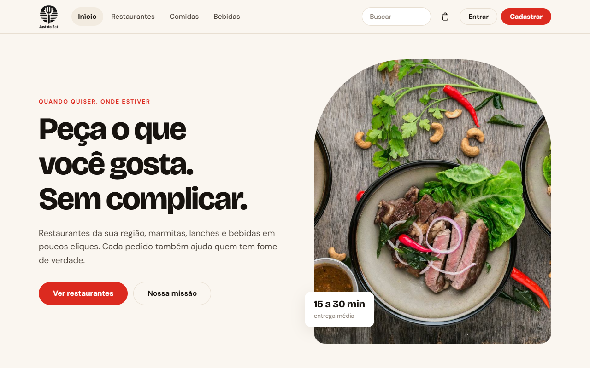
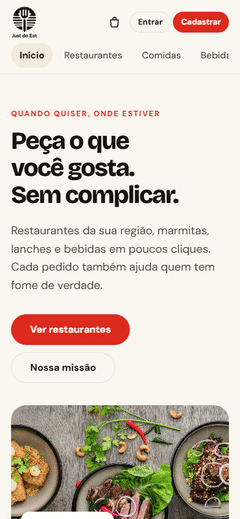
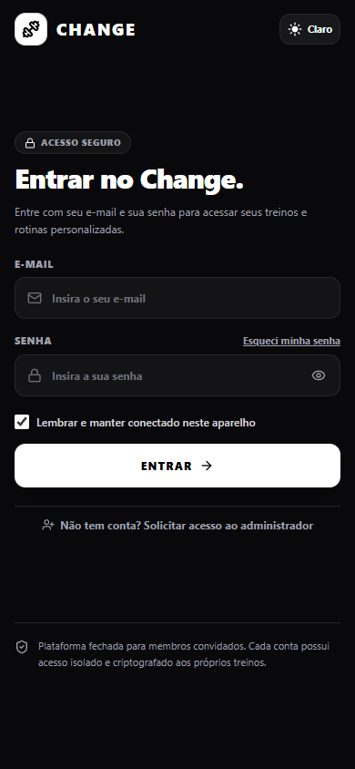
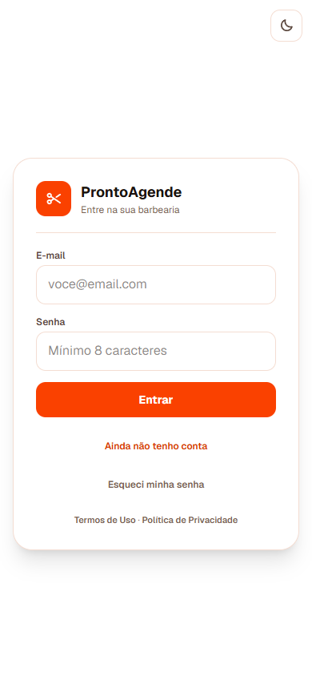

# Aristeu José de Souza Junior — AI Builder Portfolio

Construo produtos de ponta a ponta usando IA como alavanca: agentes de código, memória compartilhada entre agentes, apps deployados e ferramentas que eu mesmo uso todo dia. Este repositório reúne o que construí, o que cada coisa faz e o que é real (e o que ainda não é).

> Candidatura: Programa de Estágio GenAI (iFood), trilha AI Builder.

## Resumo rápido

| Projeto | O que é | IA entra como | Estado |
|---|---|---|---|
| [Second Brain](#1-second-brain--memória-persistente-para-agentes) | Vault Obsidian que serve de memória compartilhada entre agentes de IA | Agentes (Claude Code, Antigravity) leem e escrevem estado | Em uso diário |
| [Finanças](#2-finanças--registro-por-frase) | App financeiro local-first com registro por frase em português | Parser determinístico (decisão consciente: sem LLM) | Em produção |
| [Just do Eat](#3-just-do-eat--delivery-com-doações-automáticas) | Delivery com doações automáticas (dupla, FATEC) | Projeto acadêmico, sem IA no produto | No ar |
| [Change](#4-change--engenharia-reversa-assistida-por-ia) | App de musculação, 112 exercícios | Engenharia reversa e construção assistidas por agente | Em produção |
| [ProntoAgende BR](#5-sites-e-sistemas-para-clientes-reais) / Flow Fitness / Santa Cifra | Sistemas e sites entregues | Construídos de ponta a ponta com agentes de código | No ar |

Também há um [protótipo de assistente de voz](#experimento-daemon-protótipo-pausado) que não está em operação; está descrito com honestidade no fim.

Stack comum: TypeScript, React 19, Next.js 15, Tailwind 4, Node.js, Vercel, GitHub Pages.

---

## 1. Second Brain — memória persistente para agentes

**Problema:** agentes de IA esquecem tudo a cada sessão.

**Solução:** vault Obsidian com schema próprio (`CLAUDE.md`) que define o que cada agente pode ler e escrever.
- Cada agente tem `context.md` (onde parou), `memory.md` (fatos duráveis) e `log/AAAA-MM-DD.md`.
- Cada projeto tem `spec`, `decisions` e `progress`.
- Regras de permissão: áreas só-humano, áreas só-IA, camada imutável de fontes.
- Hook de início de sessão injeta o contexto do vault automaticamente.
- Mais de 10 projetos documentados; agentes diferentes (Claude Code, Antigravity) continuam o trabalho um do outro lendo os mesmos arquivos.

Isso é orquestração de agentes na prática: contratos de arquivo, memória compartilhada e rastreabilidade de decisões.

## 2. Finanças — registro por frase

Digito "mercado 24,50 vitória" ou "shein 81 6x vitoria" e o app entende valor, categoria, pessoa, data e parcelas.

**Decisão de engenharia:** usei parser **determinístico, sem LLM**. É rápido, grátis, offline e auditável, e dinheiro não pode "alucinar". Aprende apelidos quando corrijo. Saber quando *não* usar IA também é parte do trabalho.

Stack: React 19, TypeScript, Dexie (IndexedDB), PWA, testes com Vitest. Valores em centavos inteiros. App de uso pessoal com dados reais, por isso o repo é privado e não há prints.

## 3. Just do Eat — delivery com doações automáticas

Plataforma web de delivery que conecta clientes a restaurantes e destina um percentual de cada pedido a um fundo solidário (programa "Parcela Amiga", alinhado aos ODS 2, 3 e 9 da ONU). Projeto em dupla na FATEC, apresentado na XII Feira Tecnológica.

- Node.js com arquitetura MVC, API, PostgreSQL, deploy serverless na Vercel.
- 3 perfis (cliente, restaurante, administrador) com senhas em bcrypt.
- Fluxo completo: carrinho, checkout, acompanhamento; painéis de restaurante e admin.

**No ar:** https://justdoeat-kohl.vercel.app

| Desktop | Mobile (rolagem) |
|---|---|
|  |  |

## 4. Change — engenharia reversa assistida por IA

App mobile/PWA de musculação com 112 exercícios, demonstrações 3D e montador de treinos. Estudei um app de referência com ferramentas de engenharia reversa conduzidas por agente e reconstruí as funcionalidades. Acesso restrito a membros convidados, por isso só a tela de login é pública.

**No ar:** https://aristeu-junior.github.io/change-app/ · Repo: https://github.com/Aristeu-Junior/change-app

## 5. Sites e sistemas para clientes reais

Construídos de ponta a ponta com agentes de código (Claude Code), com revisão de design e deploy.

**Flow Fitness**: site de academia real (Ferraz de Vasconcelos/SP), redesenhado por completo. https://aristeu-junior.github.io/flow-fitness-academia/

**Santa Cifra**: PWA e APK de cifras litúrgicas. https://santa-cifra.surge.sh · https://github.com/Aristeu-Junior/santa-cifra

**ProntoAgende BR**: ERP de agendamento, caixa e lembretes para barbearias (acesso por login). https://aristeu-junior.github.io/pronto-agende-br/ · https://github.com/Aristeu-Junior/pronto-agende-br

## Experimento: DAEMON (protótipo pausado)

Assistente de voz em Python/FastAPI com Gemini e function calling sobre Google Calendar e Gmail, transcrição local com faster-whisper. **Não está em operação hoje.** Mantenho aqui pelo que aprendi:
- Ferramentas começaram como mock; troquei o Calendar pela API real e documentei o que seguia mock (WhatsApp).
- O microfone captava a própria voz do assistente e entrava em loop; separar estados de escuta e fala resolveu.
- Fallback sem modelo evita que o app quebre quando a chave de API falha.

---

## Como trabalho com IA

1. Escrevo a spec antes de pedir código (problema, escopo, o que fica fora).
2. Divido em tarefas pequenas e verificáveis; rodo testes e build antes de dar como pronto.
3. Registro decisões e o porquê, para o próximo agente (ou eu) não refazer.
4. Descrevo o que é real e o que é mock.
5. Escolho IA só onde ela ganha de uma regra simples.

## Contato

- GitHub: https://github.com/Aristeu-Junior
- E-mail: aristeu2304@gmail.com
- LinkedIn: https://linkedin.com/in/dev-aristeu-junior
